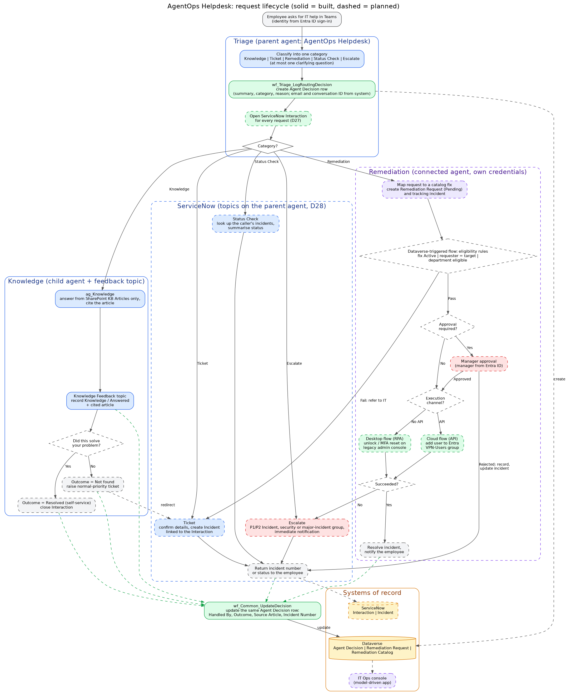
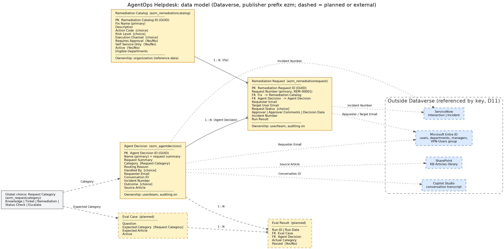

# AgentOps Helpdesk: Solution Design Document

| | |
|---|---|
| **Version** | 1.0 |
| **Date** | 16 Oct 2026 |
| **Author** | Syed Ezam Zaidi |
| **Platform** | Microsoft Copilot Studio, Power Automate, Dataverse, SharePoint, Microsoft Entra ID, ServiceNow |
| **Environment** | Portfolio-Dev (developer environment), solution *AgentOps Helpdesk*, publisher `ezm` |
| **Status** | Triage, logging, Knowledge with Yes/No feedback built and tested; ServiceNow, Remediation, ops console and deployment pipeline to be built |

Related documents: [Design decisions](decisions.md) · [Data model](data-model.md) · [Flows](flows.md) · [Platform notes](platform-notes.md) · [Triage instructions](../agent/triage-instructions.md) · [Topics](../agent/topics.md) · [Knowledge agent](../agent/knowledge-agent.md)

---

## 1. Executive summary

AgentOps Helpdesk is a multi-agent IT helpdesk in Microsoft Teams. An employee describes an IT need in plain language. A triage agent classifies it into one of five categories, records the decision in Dataverse, and hands it to a specialist:

- **Knowledge** questions are answered from the IT knowledge base, with the article cited.
- **Tickets**, **status checks** and **escalations** go to ServiceNow, IT's system of record.
- **Routine account fixes** (unlock an account, reset MFA, grant VPN access) run as automated remediations behind eligibility rules, manager approval and a least-privilege service account.

Every request gets one Agent Decision row that each stage completes: what was asked, how it was classified and why, who handled it, how it ended and which article or incident was involved. That row is the audit trail and the source of every KPI.

The design principle throughout: **the AI interprets; rules, people and least-privilege accounts decide and act.**

---

## 2. Business case

### 2.1 Problem statement

The IT service desk receives a high volume of requests that fall into a few repeatable patterns. Most can be answered from existing documentation or fixed with a standard action. Today every one of them reaches a human agent through a portal form, an email or a phone call, so:

1. **Employees wait for answers that already exist.** How-to questions (VPN, MFA, Teams, Wi-Fi) are documented, but people don't find the article and raise a ticket instead.
2. **Skilled analysts spend their time on routine work.** Account unlocks, MFA resets and access requests follow a fixed procedure, yet each needs an analyst to pick it up, check eligibility, get approval and run the steps.
3. **Requests are poorly categorised at intake.** Free-text tickets are miscategorised or routed to the wrong queue, which adds a re-triage step and delays urgent issues such as compromised accounts.
4. **Self-service has no measurable outcome.** When a knowledge article does solve the problem, nothing is recorded. IT can't see its deflection rate, which articles work, or where the knowledge base has gaps.
5. **Automation is hard to trust.** Earlier chatbot or RPA attempts either did too little (FAQ bots) or acted with broad permissions and no audit trail, so security teams resist automating account changes.

### 2.2 Objectives

| # | Objective | How the design meets it |
|---|---|---|
| O1 | Answer documented how-to questions instantly, in Teams | Knowledge agent grounded only in the IT knowledge base, with citations |
| O2 | Classify every request consistently at intake | Triage agent with a fixed five-category policy, measured against an evaluation set |
| O3 | Automate routine account fixes safely | Allow-listed fixes, deterministic eligibility rules, risk-based manager approval, least-privilege execution |
| O4 | Keep ServiceNow as the system of record | Interactions for every request, incidents for real work, auto-resolved when automation succeeds |
| O5 | Make outcomes measurable | One Agent Decision row per request with category, handler, outcome, cited article and incident number |
| O6 | Be auditable and governable | Dataverse auditing, identity from the platform (never from the AI), solution-based ALM |

### 2.3 Value model

The benefit is the analyst time no longer spent on requests that the agent resolves or fully prepares. It can be estimated with the organisation's own ServiceNow data:

```
Monthly hours saved =
    (knowledge requests resolved by self-service × average handling time of a how-to ticket)
  + (remediations completed automatically × average handling time of that fix)
  + (requests correctly categorised at intake × average re-triage time avoided)
```

**Illustrative scenario (assumptions, to be replaced with real ServiceNow figures):** 2,000 IT requests a month; 25% how-to questions, of which 40% are resolved by self-service at 10 minutes each; 10% routine fixes, of which 70% complete automatically at 20 minutes each. That gives 200 × 10 min + 140 × 20 min = **about 80 analyst hours a month**, before counting faster resolution for employees or fewer miscategorised tickets.

The design makes this calculation **measurable rather than estimated**: every input to the formula is a count of Agent Decision rows by Category and Outcome.

### 2.4 KPIs

| KPI | Definition | Source |
|---|---|---|
| Self-service resolution rate | Knowledge requests with Outcome = Resolved (self-service) ÷ all Knowledge requests | Agent Decision |
| Knowledge gap rate | Outcome = Not found, grouped by Source Article | Agent Decision |
| Automation rate | Remediation requests with Outcome = Remediated ÷ all Remediation requests | Agent Decision, Remediation Request |
| Routing accuracy | Categories matching the expected label in the evaluation set | Evaluation runs |
| Escalation volume | Category = Escalate per period | Agent Decision |
| Contact volume and deflection in IT's own reporting | Interactions closed without an incident | ServiceNow |

### 2.5 Options considered

| Option | Why not chosen |
|---|---|
| FAQ chatbot over the knowledge base only | Answers questions but can't raise tickets, run fixes or measure outcomes |
| ServiceNow Virtual Agent | Strong inside ServiceNow; the identity, approvals and automation estate here is Microsoft 365 / Entra ID / Power Platform, and Teams is where employees work |
| RPA bots triggered from tickets | Automates the fix but not the intake; still needs an analyst to read and categorise the ticket |
| **Copilot Studio multi-agent design (chosen)** | Native to Teams and Entra ID, Dataverse for governed data, Power Automate for deterministic steps, ServiceNow kept as the system of record |

---

## 3. Scope

**In scope (v1)**
- Teams channel; employees authenticated with Microsoft Entra ID
- Five request categories: Knowledge, Ticket, Remediation, Status Check, Escalate
- Knowledge base of 8 IT articles in SharePoint ([knowledge/](../knowledge/README.md))
- ServiceNow incidents and interactions (developer instance)
- Three remediations: unlock account, reset MFA, enable VPN access
- Agent Decision audit trail, IT Ops console, evaluation sets, Dev to Test deployment

**Out of scope (v1)**
- Requests about another person's account (classified as Escalate, never automated)
- Hardware fulfilment, software installation, licence requests
- Languages other than English, voice channels
- Production deployment and a real customer ServiceNow instance

**Assumptions**
- Employees use Teams with Entra ID single sign-on, so the requester's identity always comes from the platform.
- Managers and departments are maintained in Entra ID.
- The legacy admin console used by the desktop-flow fixes has no API (it is a stand-in application for this project).

---

## 4. Solution overview

### 4.1 Design principles

| Principle | Decision |
|---|---|
| The AI proposes; rules, people and least privilege decide | [D4](decisions.md#d4-the-ai-proposes-rules-humans-and-least-privilege-decide) |
| Deterministic values never come from the AI (identity, conversation, fixed outcomes) | [D16](decisions.md#d16-deterministic-values-never-come-from-the-ai) |
| Determinism in proportion to the cost of error | [D22](decisions.md#d22-determinism-in-proportion-to-the-cost-of-error) |
| Knowledge lives only in the specialist agent | [D23](decisions.md#d23-knowledge-lives-only-in-the-specialist-agent) |
| One row per request, completed by each stage | [D24](decisions.md#d24-one-row-per-request-completed-by-each-stage) |
| API first, RPA only where there is no API | [D6](decisions.md#d6-api-first-rpa-only-where-there-is-no-api) |
| ServiceNow is the system of record for IT work | [D10](decisions.md#d10-every-remediation-creates-a-servicenow-incident), [D27](decisions.md#d27-interactions-for-every-request-incidents-only-for-work) |

### 4.2 Components

| Component | Type | Role | Status |
|---|---|---|---|
| AgentOps Helpdesk (Standard) | Copilot Studio agent, generative orchestration, GPT-5 Chat | Triage: classifies, logs, hands off | Built |
| ag_Knowledge | Child agent | Answers from the SharePoint knowledge base with citations | Built |
| Knowledge Feedback | Topic on the parent agent | Records the Knowledge outcome; Yes/No closing question | Built |
| Escalate | System topic, scoped description | Only for explicit requests to talk to a person | Built |
| Raise Ticket, Raise Urgent Incident, Check Ticket Status | Topics on the parent agent (D28) | Tickets, escalations, status checks in ServiceNow | To build |
| Remediation agent | Connected agent with its own credentials | Maps requests to catalog fixes; execution runs in flows | To build |
| wf_Triage_LogRoutingDecision | Agent flow | Creates the Agent Decision row | Built |
| wf_Common_UpdateDecision | Agent flow | Updates the same row with handler, outcome, article, incident | Built |
| Remediation flows | Dataverse-triggered cloud flow, approval, cloud flow (Graph), desktop flows | Eligibility, approval, execution | To build |
| Dataverse tables | Agent Decision, Remediation Catalog, Remediation Request | Audit trail, policy, remediation lifecycle | Built |
| IT Knowledge Base | SharePoint communication site, *KB Articles* library | Knowledge source | Built |
| IT Ops console | Model-driven Power App | Review decisions, remediations and the catalog | To build |

---

## 5. Process flow



Source: [solution-flow.drawio](diagrams/solution-flow.drawio) (open in draw.io) · [PDF](diagrams/solution-flow.pdf)

### 5.1 Common path (every request)

1. The employee writes in Teams. Their identity comes from the Entra ID sign-in.
2. The Triage agent classifies the request into exactly one category, asking at most one clarifying question. Greetings and small talk are not classified.
3. `wf_Triage_LogRoutingDecision` creates the Agent Decision row: AI-generated summary, category and reason; requester email and conversation ID bound to system variables; Handled By = Triage.
4. A ServiceNow Interaction is opened for the contact (planned, D27).
5. The request is handed to the specialist for its category.

### 5.2 By category

| Category | Path | Handled By | Outcome values |
|---|---|---|---|
| **Knowledge** | ag_Knowledge answers from the knowledge base and cites the article → Knowledge Feedback records the outcome → "Did this solve your problem?" | Knowledge | Answered → Resolved (self-service) or Not found. *Not found* raises a normal-priority ticket. |
| **Ticket** | *Raise Ticket* topic confirms the details, creates an incident linked to the interaction, returns the number | ServiceNow | Ticket Created (+ Incident Number) |
| **Status Check** | *Check Ticket Status* topic looks up the caller's incidents and summarises their status | ServiceNow | Answered |
| **Escalate** | *Raise Urgent Incident* topic creates a P1/P2 incident for the security or major-incident group and notifies it immediately; security incidents also get "change your password now" advice | ServiceNow | Escalated (+ Incident Number) |
| **Remediation** | Remediation agent maps the request to a catalog fix and creates a Remediation Request and a tracking incident → eligibility rules → manager approval if required → execution by API or desktop flow → incident resolved or escalated | Remediation | Remediated or Failed (+ Incident Number) |

A request abandoned before hand-off keeps Handled By = Triage with no outcome, which is itself a measurable drop-off.

### 5.3 Outcome recording

All specialists write their result through the same flow, `wf_Common_UpdateDecision`, so the row is completed the same way whoever handled the request:

- The row is found by **Conversation ID** (from the platform), not by anything the AI produces.
- **Handled By** and **Outcome** are fixed values set by the calling topic, mapped to choice values in visible Switch cases; an unknown value stops the run instead of writing a wrong value.
- **Source Article** and **Incident Number** are written only when passed, so one stage never blanks a value another stage recorded.

### 5.4 Remediation controls

| Layer | Control | Can a crafted message influence it? |
|---|---|---|
| Identity | Requester from the Teams / Entra ID sign-in | No: comes from the platform |
| Intent | Agent maps the message to a catalog fix | Yes, so the agent has no power to act |
| Allow-list | Only fixes listed and Active in the Remediation Catalog | No: data, changed under change control |
| Eligibility | Self-service only (requester = target), department eligible, not already applied | No: deterministic flow rules |
| Approval | Requester's manager from Entra ID for medium and high-risk fixes | Human decision |
| Execution | Dedicated service account scoped to the minimum (e.g. owner of one group) | Limited blast radius |
| Audit | Remediation Request row, Agent Decision row, ServiceNow incident | Recorded regardless |

Seeded fixes: unlock account (low risk, desktop flow, no approval), enable VPN access (medium, API, approval, Engineering and IT only), reset MFA (high, desktop flow, approval).

---

## 6. Agents and topics

### 6.1 Triage (AgentOps Helpdesk, parent agent)
- **Model:** GPT-5 Chat, generative orchestration. Authentication: Microsoft Entra ID.
- **Instructions:** fixed category definitions, one clarifying question at most, Escalate when a request fits two categories or concerns another person's account, call the logging tool exactly once, plain-language confirmation with no internal labels, JSON or timeline promises. Full text: [triage-instructions.md](../agent/triage-instructions.md).
- **Holds no knowledge source**, so it can't answer directly and skip classification and logging (D23).

### 6.2 ag_Knowledge (child agent)
- Grounded in the SharePoint *KB Articles* library only; general knowledge and web search off.
- Cites the article; says so when the knowledge base doesn't cover the question; refers account changes to the helpdesk instead of describing workarounds. Details: [knowledge-agent.md](../agent/knowledge-agent.md).

### 6.3 Knowledge Feedback (topic)
- Runs after ag_Knowledge answers. Receives the cited article as an input extracted from the answer (the only AI-filled value in the topic).
- Records Knowledge / Answered and the article at once, so the outcome is attributed even if the employee leaves without answering the question.
- Asks "Did this solve your problem?" with Yes/No buttons; Yes records Resolved (self-service), No records Not found and redirects to the Raise Ticket topic once it exists. Details: [topics.md](../agent/topics.md).

### 6.4 ServiceNow topics (to build)
- Three topics on the parent agent instead of a child agent, so priority, handler and outcome are fixed per path (D28):
  - **Raise Ticket**: AI-written summary → `wf_ServiceNow_CreateIncident` (normal priority) → `wf_Common_UpdateDecision` (ServiceNow / Ticket Created / incident number). Also reached by redirect from Knowledge Feedback's No branch.
  - **Raise Urgent Incident**: the same with high priority and the security or major-incident group (ServiceNow / Escalated).
  - **Check Ticket Status**: `wf_ServiceNow_GetMyIncidents` filtered by the signed-in email → AI summarises → ServiceNow / Answered.
- Flows connect as a ServiceNow integration user with the `itil` role and web-service-only access.

### 6.5 Remediation (connected agent, to build)
- A separate agent with its own credentials, evaluation and release cycle (D21). Triage can request a fix but never holds the permissions to make one.
- Asynchronous: the agent creates the Remediation Request; a Dataverse-triggered flow applies the rules, runs the approval and executes (D22).

---

## 7. Flows

| Flow | Trigger | Called by | Credentials | Status |
|---|---|---|---|---|
| `wf_Triage_LogRoutingDecision` | When an agent calls the flow | Triage (tool, maker credentials) | Embedded Dataverse connection | Built, evaluated |
| `wf_Common_UpdateDecision` | When an agent calls the flow | Knowledge Feedback topic; later ServiceNow and Remediation | Embedded Dataverse connection | Built, unit and integration tested |
| `wf_ServiceNow_CreateIncident`, `wf_ServiceNow_GetMyIncidents` | When an agent calls the flow | ServiceNow topics | ServiceNow connection (integration user, `itil`) | To build |
| `wf_ServiceNow_UpdateIncident` | Child flow | Remediation orchestration (resolve or escalate) | ServiceNow connection (integration user) | To build with Remediation |
| Remediation eligibility and orchestration | Dataverse: Remediation Request created | Platform | Service account | To build |
| Manager approval | Within the orchestration flow | Platform | Approvals | To build |
| Enable VPN access | Child flow | Orchestration flow | Entra ID / Graph, scoped service account | To build |
| Unlock account, reset MFA | Desktop flows | Orchestration flow | Machine and service account for the legacy console | To build |

Specifications: [flows.md](flows.md). Naming: `wf_<Agent>_<Action>`, with the tool on the agent carrying the same name where the platform allows (D20).

---

## 8. Data model



Source: [data-model.drawio](diagrams/data-model.drawio) · [PDF](diagrams/data-model.pdf)

All tables are in the *AgentOps Helpdesk* solution with publisher prefix `ezm`. No column is marked required; validation happens in the flows that write the rows (D14).

### 8.1 Agent Decision (`ezm_agentdecision`)

One row per request. Ownership: user or team. Auditing on.

| Column | Logical name | Type | Written by | Notes |
|---|---|---|---|---|
| Agent Decision ID | `ezm_agentdecisionid` | Unique identifier (PK) | Dataverse | Returned to the agent as DecisionId |
| Name (primary) | `ezm_name` | Text (500) | Triage flow | Set to the request summary |
| Request Summary | `ezm_requestsummary` | Multiple lines | Triage flow (AI) | One sentence with conversation context (D15) |
| Category | `ezm_category` | Choice (global Request Category) | Triage flow (AI, fixed list) | Knowledge, Ticket, Remediation, Status Check, Escalate |
| Routing Reason | `ezm_routingreason` | Multiple lines | Triage flow (AI) | For debugging and evaluation |
| Handled By | `ezm_handledby` | Choice | Triage flow, then update flow | Triage, Knowledge, ServiceNow, Remediation, Escalation |
| Requester Email | `ezm_requesteremail` | Email | Triage flow (`System.User.Email`) | Never generated by the AI |
| Conversation ID | `ezm_conversationid` | Text | Triage flow (`System.Conversation.Id`) | Links to the transcript; used to find the row |
| Incident Number | `ezm_incidentnumber` | Text | Update flow | ServiceNow key |
| Outcome | `ezm_outcome` | Choice | Update flow | Answered, Ticket Created, Remediated, Escalated, Failed, Resolved (self-service), Not found |
| Source Article | `ezm_sourcearticle` | Text (20) | Update flow | KB article cited, e.g. KB-002 |

### 8.2 Remediation Catalog (`ezm_remediationcatalog`)

Approved automated fixes; the allow-list. Ownership: organization. Auditing on.

| Column | Type | Notes |
|---|---|---|
| Fix Name (primary) | Text | Human-readable |
| Description | Multiple lines | When the fix applies |
| Action Code | Choice | UNLOCK_ACCOUNT, RESET_MFA, ENABLE_VPN_ACCESS (stable machine key) |
| Risk Level | Choice | Low, Medium, High |
| Execution Channel | Choice | API, Desktop Flow |
| Requires Approval | Yes/No | Default Yes |
| Self Service Only | Yes/No | Default Yes |
| Active | Yes/No | Soft delete |
| Eligible Departments | Multiple lines | Comma-separated Entra departments; blank means all |

### 8.3 Remediation Request (`ezm_remediationrequest`)

Each attempt to run a catalog fix. Ownership: user or team. Auditing on.

| Column | Type | Notes |
|---|---|---|
| Request Number (primary) | Autonumber | `REM-00001` |
| Fix | Lookup → Remediation Catalog | |
| Agent Decision | Lookup → Agent Decision | Links back to the conversation |
| Requester Email | Email | Verified identity |
| Target User Email | Email | Must match the requester when Self Service Only |
| Request Status | Choice | Pending Approval (default), Approved, Rejected, Running, Succeeded, Failed |
| Approver, Approver Comments, Decision Date | Text, Multiple lines, Date and time | |
| Incident Number | Text | ServiceNow key |
| Run Result | Multiple lines | API or desktop flow output, or the error |

### 8.4 Relationships and external keys

| From | To | Type |
|---|---|---|
| Remediation Catalog | Remediation Request | 1 : N (Fix) |
| Agent Decision | Remediation Request | 1 : N (Agent Decision) |
| Agent Decision | Copilot Studio transcript | Text key: Conversation ID |
| Agent Decision, Remediation Request | ServiceNow incident | Text key: Incident Number (D11) |
| Agent Decision, Remediation Request | Entra ID user | Email |
| Agent Decision | SharePoint article | Text key: Source Article |

Identity data (departments, managers, group membership) stays in Entra ID and is read at runtime (D9).

### 8.5 Choice values

| Handled By | Value | Outcome | Value | Request Category | Value |
|---|---|---|---|---|---|
| Triage | 791760000 | Answered | 791760000 | Knowledge | 791760000 |
| Knowledge | 791760001 | Ticket Created | 791760001 | Ticket | 791760001 |
| ServiceNow | 791760002 | Remediated | 791760002 | Remediation | 791760002 |
| Remediation | 791760003 | Escalated | 791760003 | Status Check | 791760003 |
| Escalation | 791760004 | Failed | 791760004 | Escalate | 791760004 |
| | | Resolved (self-service) | 791760005 | | |
| | | Not found | 791760006 | | |

### 8.6 Proposed: evaluation tables

To move evaluation from exported CSVs into the platform:

- **Eval Case**: Question, Expected Category (Request Category), Expected Article, Active.
- **Eval Result**: Run ID, Run Date, Eval Case (lookup), Agent Decision (lookup), Actual Category, Passed.

---

## 9. Integrations

| System | Purpose | Method |
|---|---|---|
| Microsoft Teams | Employee channel | Copilot Studio Teams channel |
| Microsoft Entra ID | Sign-in, requester identity, manager and department lookup, VPN-Users group | Platform authentication; Office 365 Users / Graph in flows |
| SharePoint | IT knowledge base | Copilot Studio knowledge source on the *KB Articles* library (permission-trimmed) |
| Dataverse | Audit trail, policy, remediation lifecycle | Dataverse connector through connection references |
| ServiceNow | Interactions, incidents, status | ServiceNow connector against a developer instance |
| Legacy admin console | Unlock and MFA reset | Power Automate Desktop (no API) |

---

## 10. Security and governance

- **Identity from the platform.** Requester email and conversation ID are bound to system variables; the AI fills only judgement values (summary, category, reason) and the extracted article ID (D16).
- **Audit writes on the automation's identity.** Logging tools use maker-provided credentials with the flow's embedded connection; employees never need write access to the audit tables. In Test and Prod the connection references map to a least-privilege service account (D17).
- **Credential mode verified before deployment.** Each exported flow must show `runtimeSource: embedded` and each agent tool `mode: Maker`. Agent flows created from Copilot Studio were found to carry `invoker` even when maker credentials were selected (D18, [platform note 1](platform-notes.md#1-agent-flow-runs-with-the-callers-connection-despite-maker-credentials)).
- **Prompt injection is contained, not prevented.** A crafted message can at most cause a misclassification; eligibility rules, approval and a scoped execution account stop it from causing an unauthorised change (D4).
- **Knowledge is permission-trimmed**: answers come only from articles the employee can read.
- **Auditing** is on for all three tables; Dataverse keeps the change history of each row.
- **Separation of duties**: Remediation runs as its own agent with its own credentials, so a compromise of Triage can't change an account (D21).

---

## 11. Application lifecycle management

| Environment | Purpose |
|---|---|
| Portfolio-Dev | Build (developer environment, unmanaged solution) |
| Portfolio-Test | Managed solution import to prove the solution has no hidden dependencies |

- Everything lives in the *AgentOps Helpdesk* solution: tables, choices, flows, connection references, agent and topics.
- Agent flows are built in the classic Power Automate designer inside the solution, then attached as tools; the export is checked after attaching ([platform note 1](platform-notes.md#1-agent-flow-runs-with-the-callers-connection-despite-maker-credentials)).
- **Deployment pipeline (planned):** Power Platform Pipelines from Dev to Test, then GitHub Actions with the Power Platform CLI to export, unpack into this repository and import the managed solution. The pipeline fails the deployment if any flow shows `runtimeSource: invoker`, turning D18 from a manual check into an automated gate.

---

## 12. Testing and evaluation

| Layer | What is tested | Result so far |
|---|---|---|
| Flow unit tests | Each flow run in isolation with fixed inputs; **every case of every mapping Switch** | `wf_Common_UpdateDecision`: passed after fixing a trailing-space case value found in integration ([write-up](flows.md#defect-found-in-integration-07-oct-2026)) |
| Routing evaluation | 20 single-turn cases, 3 to 5 per category | **20 / 20** categories correct ([baseline](../eval/results/2026-10-03-triage-baseline.md), [regression](../eval/results/2026-10-04-triage-standard-20case.md)) |
| Reply policy | No internal labels, JSON, tool names or timeline promises | 5 / 5 after fixes |
| Knowledge evaluation | 6 covered questions + 2 out-of-scope ([test set](../eval/knowledge-test-set.csv)); grounded answer, correct citation, no answer outside the KB | To run |
| End-to-end | Teams conversation to the completed Agent Decision row, per category | Knowledge path verified, including Yes feedback |

Evaluation runs are executed in batches of five to stay under the orchestration rate limit (`GenAIToolPlannerRateLimitReached`).

---

## 13. Non-functional requirements

| Area | Target / approach |
|---|---|
| Response time | Knowledge answer within about 15 seconds in Teams; logging and outcome flows within a few seconds (observed 3 to 14 seconds per step in the test pane) |
| Availability | Platform SLAs (Copilot Studio, Power Automate, Dataverse); if a logging flow fails the employee still gets an answer and the failure is visible in run history |
| Auditability | Every request leaves an Agent Decision row; every remediation leaves a Remediation Request and a ServiceNow incident |
| Maintainability | Policy as data (catalog), visible Switch mappings instead of expressions, one shared update flow, one name per component |
| Cost | Copilot Studio messages billed pay-as-you-go; deterministic steps run in flows rather than extra model calls |
| Accessibility | Teams client accessibility; plain-language replies; buttons for Yes/No feedback |

---

## 14. Risks and mitigations

| Risk | Impact | Mitigation |
|---|---|---|
| Misclassification | Wrong specialist; a remediation request treated as a question, or the reverse | Evaluation set with regression runs; Escalate on ambiguity; remediation is still gated by rules and approval |
| Feedback topic not triggered | Knowledge outcome stays at Triage | Instruction reference plus topic description; trigger rate measured in the Knowledge evaluation |
| Wrong article ID extracted | One wrong analytics value | Value cross-checkable against the transcript by Conversation ID; low cost of error (D22) |
| Credential mode drift (`invoker`) | Consent prompts or 401 for employees | Export check before every deployment (D18); automated gate in the pipeline |
| Mapping typos in flows | Wrong or rejected values | Default branches terminate with a named error; unit test every case |
| Rate limiting during evaluation or peak use | Throttled replies | Batched evaluation; monitor throttling in production |
| ServiceNow developer instance hibernates when idle | ServiceNow steps fail during demos | Wake the instance before testing; production would use a real instance |
| Over-automation of account changes | Security incident | Allow-list, self-service only, risk-based approval, scoped service account, full audit |

---

## 15. Build status and remaining work

| Step | Build | Status |
|---|---|---|
| 1 | Dataverse tables, Entra test users and groups | Done |
| 2 | Triage agent (classification) | Done |
| 3 | Logging flow attached to Triage | Done |
| 4 | Knowledge agent with SharePoint | Done |
| 5 | Shared outcome flow and Knowledge Feedback (outcome recording) | Done |
| 6 | Yes/No closing question | Done |
| 6a | Knowledge evaluation | Next |
| 7 | ServiceNow topics and flows: tickets, escalation, status (interactions after) | To do |
| 8 | Remediation agent: rules, approval and execution flows | To do |
| 9 | IT Ops console (model-driven app) | To do |
| 10 | Publish to Teams, Dev to Test deployment, end-to-end evaluation | To do |

---

## 16. Open points for review

1. **Escalations: Handled By value.** D26 makes escalation a ServiceNow path, but the Handled By choice still has *Escalation*. Either record escalations as ServiceNow / Escalated and retire the *Escalation* value, or keep it to separate escalations in reports.
2. **Who opens the ServiceNow Interaction**: the Triage logging flow (one place, every request) or each specialist (only when it reaches ServiceNow).
3. **"No" on Knowledge feedback**: raise the ticket automatically, or offer it and let the employee confirm.
4. **Evaluation tables (8.6)**: build in Dataverse for v1, or keep evaluation in CSV exports.
